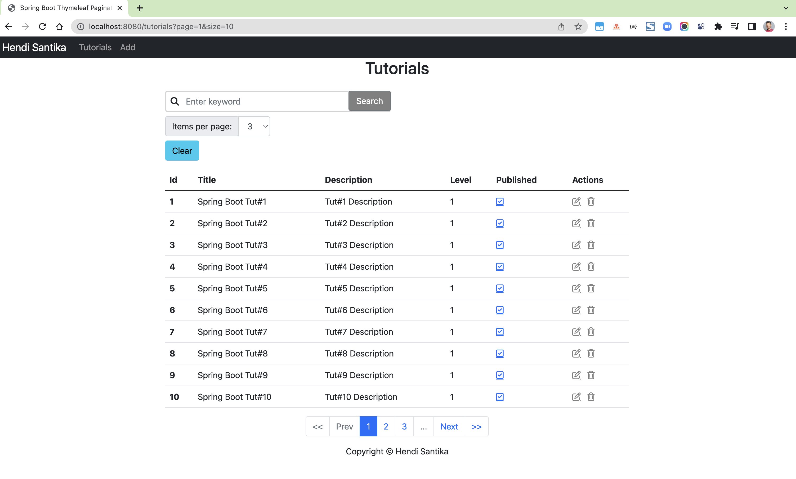
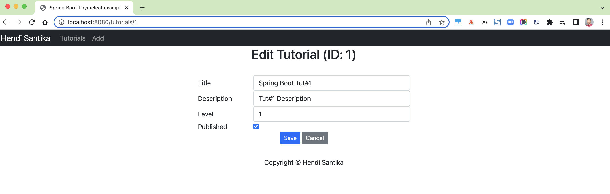

# spring-boot-thymeleaf-pagination

[](https://github.com/hendisantika/spring-boot-thymeleaf-pagination/actions/workflows/maven.yml)


A simple CRUD application that demonstrates server-side pagination and keyword search with Spring Boot, Spring Data JPA,
Thymeleaf, Bootstrap and an H2 database.

## Tech Stack

- Java 25
- Spring Boot 4.1.2 (Web, Data JPA, Thymeleaf, DevTools)
- H2 Database (file-based at runtime, in-memory for tests)
- Bootstrap 5 & jQuery via WebJars
- Lombok
- Maven (wrapper included)

## Requirements

- JDK 25 (e.g. [Eclipse Temurin](https://adoptium.net/))
- No local Maven installation needed — use the bundled `./mvnw`

## Things todo list

1. Clone this repository: `git clone https://github.com/hendisantika/spring-boot-thymeleaf-pagination.git`
2. Navigate to the folder: `cd spring-boot-thymeleaf-pagination`
3. Run the application: `./mvnw clean spring-boot:run`
4. Open your favorite browser: http://localhost:8080/tutorials
5. H2 console (optional): http://localhost:8080/h2-console — JDBC URL `jdbc:h2:file:./testdb`, user `sa`, empty password

## Build & Test

```shell
./mvnw clean verify
```

Tests run against an in-memory H2 database, so they don't depend on the local `testdb.mv.db` file.

## Continuous Integration

- **GitHub Actions** — [`.github/workflows/maven.yml`](.github/workflows/maven.yml) builds and tests the project on JDK 25 (Temurin) for
  every push and pull request to `main`, and submits the Maven dependency graph on pushes to `main`.
- **Dependabot** — [`.github/dependabot.yml`](.github/dependabot.yml) checks Maven dependencies and GitHub Actions daily
  (05:00 Asia/Jakarta). Updates are grouped (Spring Boot, WebJars, other minor/patch, GitHub Actions), labeled, and use
  Conventional Commit prefixes (`build(deps)`, `ci(deps)`).

## Image Screen shot

List All tutorials



Add New Tutorial


